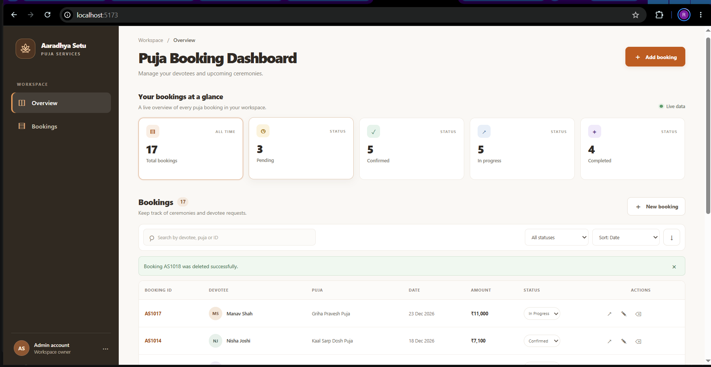
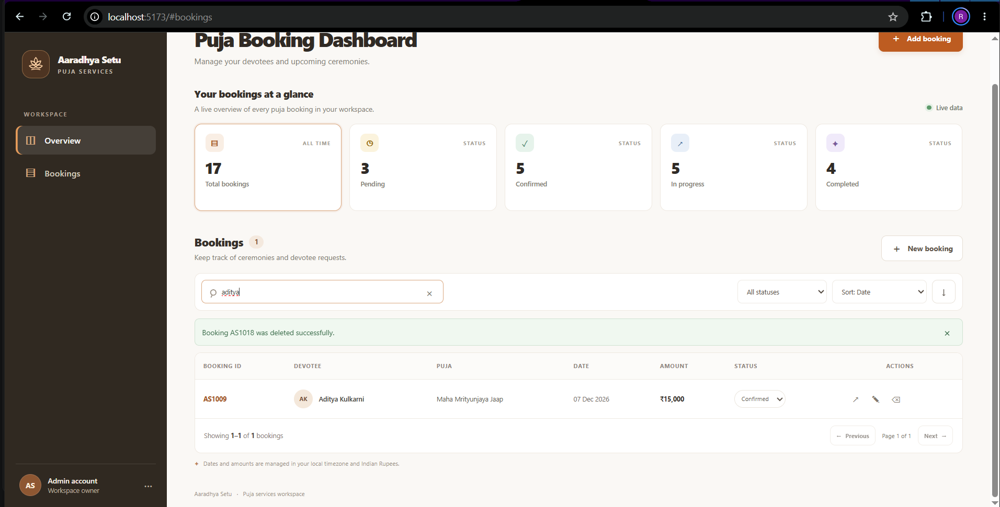
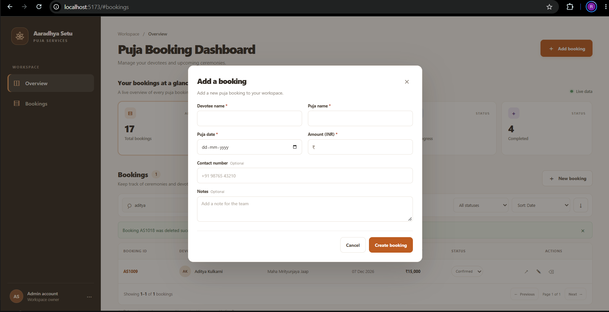
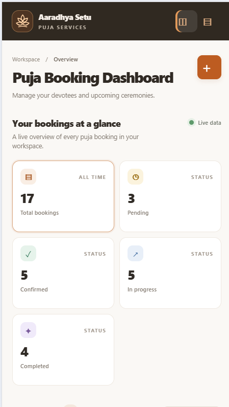

# Aaradhya Setu Puja Booking Dashboard

A responsive admin prototype for managing puja bookings. The React dashboard reads and mutates booking records through an Express API backed by MongoDB; it does not use browser storage or hardcoded booking statistics.

## Features

- Database-backed total and per-status booking summaries.
- Search by booking ID, devotee, or puja; combine with status filters, sorting, and pagination.
- View booking details, create and edit records, update status, and confirm deletion.
- Mongoose validation, safe sort-field allowlists, generated booking IDs, centralized API errors, and CORS configuration.
- Repeatable sample-data seeding that adds missing samples without deleting or overwriting existing bookings.
- Responsive layouts, accessible form labels, keyboard-dismissible dialogs, loading and empty states, and API error feedback.

This is an **admin-only demo**. It has no authentication or authorization and must not be exposed as a secure production admin system or placed on a public network without appropriate security controls.

## Tech stack and architecture

- **Frontend:** React 18, Vite, plain CSS, and the browser `fetch` API.
- **Backend:** Node.js ES modules, Express 4, Mongoose 8.
- **Database:** MongoDB Atlas or a local MongoDB server.
- **Tests:** Node's built-in test runner and Node `fetch`; integration tests use a dedicated MongoDB test database.

```text
frontend/
  public/favicon.svg
  src/
    assets/brand-mark.svg
    components/       # Sidebar, filters, table, forms, dialogs, status and pagination
    hooks/useBookings.js
    pages/Dashboard.jsx
    services/bookingService.js
    styles/global.css
    utils/formatters.js
    App.jsx
    main.jsx
  index.html
  vite.config.js
backend/
  config/db.js
  controllers/bookingController.js
  middleware/         # Async wrapper, not-found and error handling
  models/Booking.js
  routes/bookingRoutes.js
  scripts/seedBookings.js
  tests/booking.test.js
  utils/generateBookingId.js
  app.js
  server.js
```

The root `package.json` provides convenience scripts. The frontend dev server proxies `/api` to `http://localhost:5000` by default; `VITE_API_URL` can instead point it at a deployed API.

## Prerequisites

- Node.js 18.18+ (Node 20 LTS recommended) and npm.
- MongoDB Community Server running locally, or a MongoDB Atlas database.

## Install and configure (Windows PowerShell)

Run these commands from the repository root:

```powershell
npm run install:all
if (!(Test-Path backend\.env)) { Copy-Item backend\.env.example backend\.env }
if (!(Test-Path frontend\.env)) { Copy-Item frontend\.env.example frontend\.env }
```

Edit `backend\.env`:

```dotenv
PORT=5000
MONGODB_URI=mongodb://127.0.0.1:27017/aaradhya_setu
CLIENT_ORIGIN=http://localhost:5173
TEST_MONGODB_URI=mongodb://127.0.0.1:27017/aaradhya_setu_test
```

`TEST_MONGODB_URI` is used only by the integration tests. The database name must include `test` as a separate segment (for example, `aaradhya_setu_test`). Never point it at production or shared data.

The frontend defaults to the Vite `/api` proxy, so `frontend\.env` is optional for local development. To connect directly to another API, set:

```dotenv
VITE_API_URL=https://your-api.example.com/api
```

### MongoDB setup

**Local:** Install and start MongoDB Community Server, then use the local URI above. The database and collections are created as the app writes data.

**Atlas:** Create a cluster and database user in Atlas, allow the development machine's IP in Network Access, and copy the driver's connection string into `MONGODB_URI`. Replace its username, password, cluster host, and database name with your own values. Do not commit `.env` files or credentials. For deployment, configure `CLIENT_ORIGIN` as a comma-separated list of the exact trusted frontend origins.

## Run the application

With MongoDB running and `backend\.env` configured:

```powershell
# Start both Vite and Express
npm run dev

# Or start either app independently
npm run dev:backend
npm run dev:frontend
```

Open the Vite URL shown in the terminal (normally `http://localhost:5173`). The backend health endpoint is `http://localhost:5000/api/health`.

Add the sample bookings at any time:

```powershell
npm run seed
```

The seed script inserts 18 fictional samples with booking IDs `AS1001`–`AS1018`, spanning all four statuses. It upserts only by these sample IDs, inserts missing sample records, preserves existing samples as-is, and never resets or deletes other collection data. The ID counter is advanced past the sample range so newly created bookings receive a fresh ID.

## API

All responses are JSON with a `success` boolean and a human-readable `message`. Successful resources are returned in `data`; list responses also include `pagination` and a database-backed `summary`. Errors use `{ "success": false, "message": "..." }`.

### `GET /api/bookings`

List records. Query options can be combined:

- `search`: partial, case-insensitive match against booking ID, devotee name, or puja name.
- `status`: `Pending`, `Confirmed`, `In Progress`, or `Completed`.
- `sortBy`: `date` (default), `amount`, `devoteeName`, or `createdAt`.
- `order`: `asc` or `desc` (default).
- `page`: positive integer (default `1`).
- `limit`: integer from `1` to `100` (default `10`).

```http
GET /api/bookings?search=Meera&status=Confirmed&sortBy=date&order=desc&page=1&limit=10
```

The list's `summary` always reflects the complete collection, regardless of current filters; `pagination.total` reflects the filtered result count.

### `GET /api/bookings/:id`

Fetch one booking by MongoDB document ID. Returns `400` for malformed IDs and `404` when no record exists.

```http
GET /api/bookings/6659d1c8b32f3f5b52000001
```

### `POST /api/bookings`

Create a record. Required fields: `devoteeName`, `pujaName`, `date`, and non-negative numeric `amount`. `status` defaults to `Pending`; `contactNumber` and `notes` are optional. The server allocates unique `AS####` IDs with an atomic MongoDB counter and a unique index.

```json
{
  "devoteeName": "Meera Iyer",
  "pujaName": "Satyanarayan Puja",
  "date": "2026-12-05T12:00:00.000Z",
  "amount": 5100,
  "contactNumber": "+91 90000 10002",
  "notes": "Please confirm the preferred muhurat."
}
```

Returns `201` with the created record.

### `PATCH /api/bookings/:id`

Update one or more allowed fields: `devoteeName`, `pujaName`, `date`, `amount`, `contactNumber`, or `notes`. Internal properties, `bookingId`, status, and unknown fields are rejected.

```json
{ "date": "2026-12-06T12:00:00.000Z", "amount": 5500 }
```

### `PATCH /api/bookings/:id/status`

Update only the booking status. Allowed values: `Pending`, `Confirmed`, `In Progress`, and `Completed`.

```json
{ "status": "Confirmed" }
```

### `DELETE /api/bookings/:id`

Delete the record and return a confirmation message. Returns `400` for malformed IDs and `404` when the record does not exist.

## Tests and checks

Run the backend integration tests against a disposable test database configured in `TEST_MONGODB_URI`:

```powershell
$env:TEST_MONGODB_URI = "mongodb://127.0.0.1:27017/aaradhya_setu_test"
npm test
```

Integration tests read `TEST_MONGODB_URI` from the process environment and clear booking records in that database before each case. Use a disposable test database only. Its name must include `test` as a separate segment; this name check does not make shared data safe. If `TEST_MONGODB_URI` is not set, the suite is skipped; a skipped suite is **not** a passing execution of the API tests.

Build the production frontend bundle:

```powershell
npm run build
```

## Screenshots

### Dashboard Overview


### Booking Filters and Search


### Add Booking Form


### Mobile Dashboard


## Limitations and deployment notes

- Authentication, authorization, audit logging, payment collection, messaging, and production operational monitoring are intentionally out of scope.
- Booking data is persisted in MongoDB; the UI's counts and list are fetched from the API.
- API pagination is capped at 100 records per page. Search is a bounded, escaped case-insensitive regular expression and is suitable for this prototype's sample-scale dataset.
- For deployment, host the frontend static build and the backend separately or behind a reverse proxy, configure `VITE_API_URL` to the API's `/api` base URL, set a restricted `CLIENT_ORIGIN`, and provide `MONGODB_URI` through the host's secret manager. Use TLS and add authentication/authorization before exposing admin functionality.
